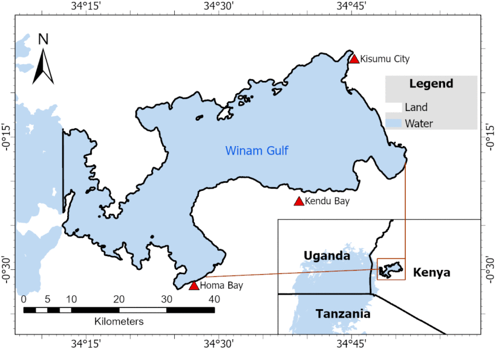
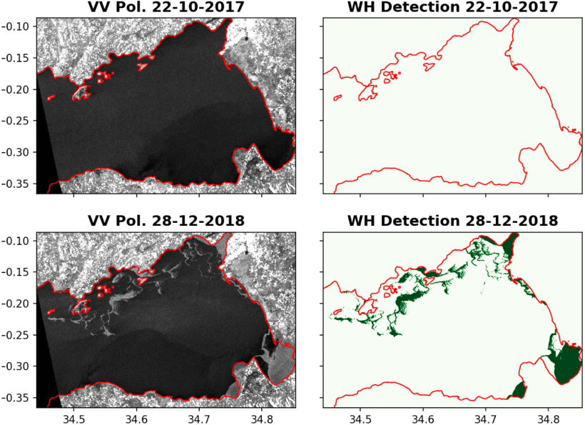
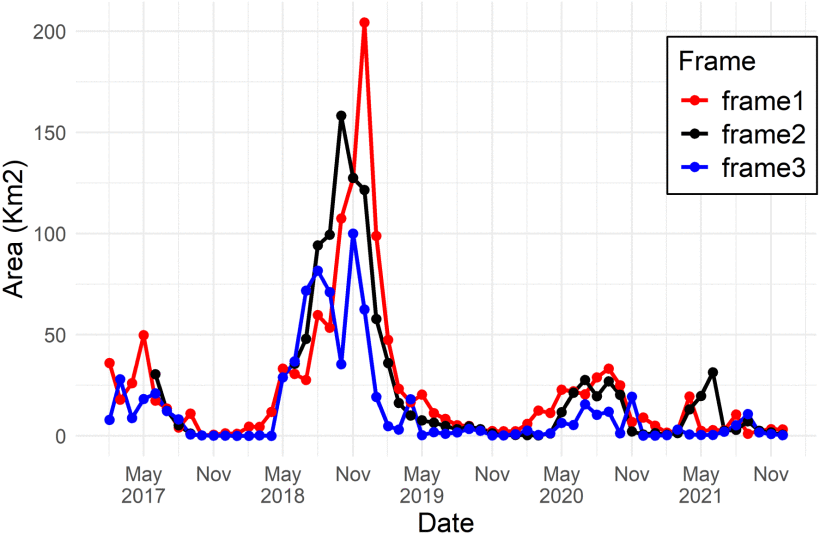

# Mapping and Monitoring of Water Hyacinth in Lake Victoria Using Polarimetric Radar Data

Code accompanying the paper published in *IEEE Journal of Selected Topics in Applied Earth Observations and Remote Sensing (JSTARS)*.

[](https://ieeexplore.ieee.org/document/10711204)
[](https://doi.org/10.1109/JSTARS.2024.3476938)

## Publication

**Felix, I. K., Marino, A., Simpson, M. D., Akbari, V., Silva, T. S. F., Datta, A., Nagendra, P. G., Pranuthi, G., & Rupavatharam, S.** (2024).
*Mapping and Monitoring of Water Hyacinth in Lake Victoria Using Polarimetric Radar Data.*
IEEE JSTARS, vol. 17, pp. 19900-19910.
[https://ieeexplore.ieee.org/document/10711204](https://ieeexplore.ieee.org/document/10711204)

## Overview

Water hyacinth is an invasive plant that forms large blooms in the Winam Gulf of Lake Victoria (Kenya). Field monitoring across such a large lake is costly and difficult, so this work uses Sentinel-1 VV-VH polarimetric SAR to map and monitor its cover.

The approach is a change detection method based on the **Optimization of Power Difference (OPDiff)** with **minimum eigenvalue selection**, which separates clear water from water hyacinth-infested water. The optimisation framework for polarimetric change detection is described in [1] and [2] (see [References](#references)).

**Key results**
- 98.89% accuracy separating clear and water hyacinth-infested water
- Peak cover in 2018, exceeding 200 km²

## Figures

### Study area

*Figure 1. Study area in the Winam Gulf, Lake Victoria.*

### Detection results

*Figure 2. Sentinel-1 VV backscatter (left) and water hyacinth detection (right).*

### Temporal trends

*Figure 3. Monthly and annual water hyacinth cover, 2017-2022.*

> Figures are reproduced from the paper. Check the IEEE copyright terms before publishing them publicly, or recreate them from your own code and data.

## Workflow

1. Download and pre-process Sentinel-1 IW SLC data
2. Generate covariance matrices from VV and VH
3. Apply OPDiff change detection (minimum eigenvalue selection)
4. Threshold the detector output to get the water hyacinth mask
5. Clip to the Lake Victoria shapefile
6. Plot and quantify monthly/annual cover

## Jupyter Notebook

The step-by-step analysis is in the notebook:

**[`notebooks/water_hyacinth_detection.ipynb`](notebooks/water_hyacinth_detection.ipynb)**

It covers:
- Loading the data
- Thresholding the OPDiff output
- Clipping to the lake boundary
- Plotting the results

## Installation

```bash
git clone https://github.com/kasitif/water-hyacinth-polsar-lake-victoria.git
cd water-hyacinth-polsar-lake-victoria
pip install -r requirements.txt
jupyter notebook notebooks/water_hyacinth_detection.ipynb
```

`requirements.txt` (suggested):
```
numpy
scipy
matplotlib
rasterio
geopandas
spectral
tqdm
jupyter
```

## Repository structure

```
.
├── README.md
├── LICENSE
├── requirements.txt
├── images/                 # figures used in the README
├── notebooks/
│   └── water_hyacinth_detection.ipynb
└── data/                   # sample data or download instructions
```

## Citation

```bibtex
@article{felix2024water,
  author  = {Felix, I. K. and Marino, A. and Simpson, M. D. and Akbari, V. and Silva, T. S. F. and Datta, A. and Nagendra, P. G. and Pranuthi, G. and Rupavatharam, S.},
  title   = {Mapping and Monitoring of Water Hyacinth in Lake Victoria Using Polarimetric Radar Data},
  journal = {IEEE Journal of Selected Topics in Applied Earth Observations and Remote Sensing},
  volume  = {17},
  pages   = {19900--19910},
  year    = {2024},
  doi     = {10.1109/JSTARS.2024.3476938}
}
```

## References

[1] A. Marino and M. Nannini, "Signal models for changes in polarimetric SAR data," *IEEE Trans. Geosci. Remote Sens.*, vol. 60, Oct. 2022, Art. no. 5212818. [Article](https://ieeexplore.ieee.org/document/9560715) | DOI: [10.1109/TGRS.2021.3113182](https://doi.org/10.1109/TGRS.2021.3113182)

[2] A. Marino and A. Alonso-Gonzalez, "Optimisations for different change models with polarimetric SAR," in *Proc. 12th Eur. Conf. Synthetic Aperture Radar (EUSAR)*, 2018, pp. 1-5. [Article](https://ieeexplore.ieee.org/document/8438090)

## License

- **Code** (`.py`, `.ipynb`): [MIT License](LICENSE)
- **Documentation and figures created for this repository**: [CC BY 4.0](https://creativecommons.org/licenses/by/4.0/)
- The published article and any figures reproduced from it are © IEEE and are not covered by these licenses.

## Contact

Felix Kasiti Isundwa, https://github.com/kasitif.
